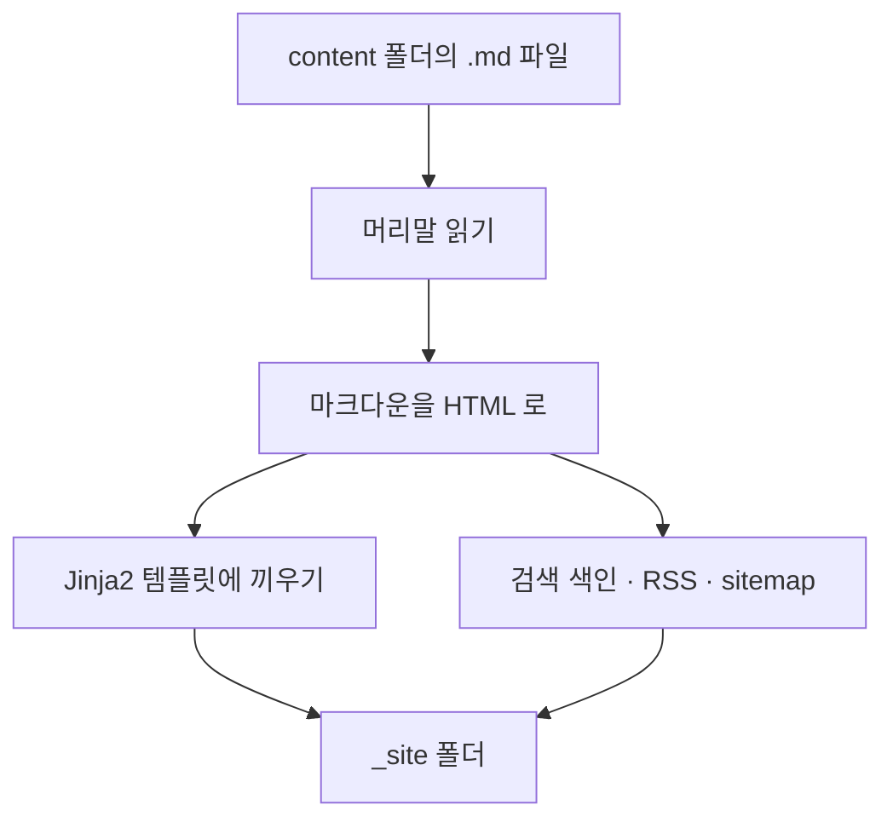

## 파일 하나로 돌아가게

생성기는 `build.py` 하나다. 맨 위에 필요한 라이브러리를 적어 두면, [uv](https://docs.astral.sh/uv/) 가 처음 실행할 때 알아서 설치한다. 가상 환경을 만들거나 `pip install` 을 따로 할 필요가 없다.

```python title="build.py 맨 위"
# /// script
# requires-python = ">=3.10"
# dependencies = [
#   "markdown-it-py>=3.0",
#   "mdit-py-plugins>=0.4",
#   "linkify-it-py>=2.0",
#   "pygments>=2.17",
#   "jinja2>=3.1",
#   "pyyaml>=6",
# ]
# ///
```

```bash
uv run --no-project build.py
```

## 한 번 빌드할 때 일어나는 일



글이 열몇 편인 지금은 빌드 한 번에 0.5초쯤 걸린다. 그래서 파일을 저장할 때마다 전체를 다시 빌드해도 기다릴 일이 없다.

## 마크다운에 기능 더하기

마크다운을 HTML 로 바꾸는 일은 markdown-it-py 가 한다. 이 라이브러리는 글을 먼저 토큰 목록으로 쪼갠 뒤 HTML 로 그리는데, 그 사이에 토큰을 손볼 수 있다. 블로그 기능 대부분은 이 틈에서 만들었다.

예를 들어 GitHub 처럼 인용문 첫 줄에 `[!NOTE]` 를 적으면 색이 있는 힌트 상자가 되게 했다. 인용문이 시작되는 토큰을 만나면, 그 첫 줄이 표시로 시작하는지 보고 상자 종류를 붙여 둔다.

```python title="build.py (줄임)"
elif tok.type == "blockquote_open":
    inline = tokens[i + 2]
    m = re.match(r"^\[!(NOTE|TIP|IMPORTANT|WARNING|CAUTION)\]\s*", inline.content)
    if m:
        tok.meta["hint"] = HINT_KINDS[m.group(1)]   # 그릴 때 이 값을 보고 상자로 만든다
```

> [!TIP]
> 이렇게 쓰면 GitHub 에서 파일을 열어 봐도 같은 모양의 상자로 보인다. 블로그 전용 문법을 새로 만들지 않아도 된다.

## 코드 블록에서 만난 버그

코드 색은 Pygments 로 입힌다. 줄마다 `<span>` 으로 감싸 왼쪽 여백을 주려고 했는데, 처음에는 첫 줄에만 여백이 들어가고 나머지 줄은 칸에 붙어 버렸다.

원인은 Pygments 가 줄을 감싸는 모양이었다. 줄 끝의 줄바꿈이 `</span>` 안쪽에 들어 있었는데, 나는 바깥에 있다고 생각하고 줄을 나누고 있었다. 지금은 줄의 시작 표시로 나누고, 줄 끝의 줄바꿈은 지운다.

```python title="build.py"
chunks = [c for c in re.split(r'(?=<span id="L-\d+">)', inner) if c.strip()]
lines = [re.sub(r"\n(?=(?:</span>)*\s*$)", "", re.sub(r'^<span id="L-\d+">', '<span class="line">', c).rstrip())
         for c in chunks]
```

## 그림 두 가지

- **다크 모드 그림:** `diagram.png` 옆에 `diagram.dark.png` 를 두면, 다크 모드에서는 그 그림을 보여 준다. 도표처럼 배경이 있는 그림이 어두운 화면에서 튀지 않는다.
- **자리 미리 잡기:** 빌드할 때 그림 파일의 가로·세로 크기를 읽어서 HTML 에 적는다. 그림이 늦게 떠도 글이 밀리지 않아서, 목차에서 제목을 누르면 정확히 그 자리로 간다.

## 다음 편

여기까지가 GitBook 수치로 만든 첫 모습이다. 다음 글에서는 그 화면이 왜 읽기 불편했는지, 토스 디자인 시스템으로 어떻게 다시 잡았는지 적는다.
