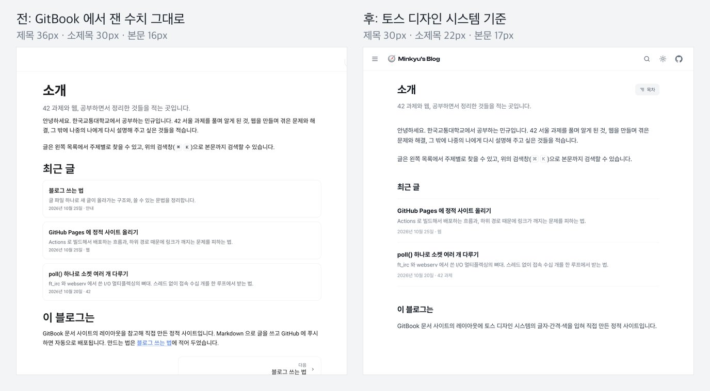
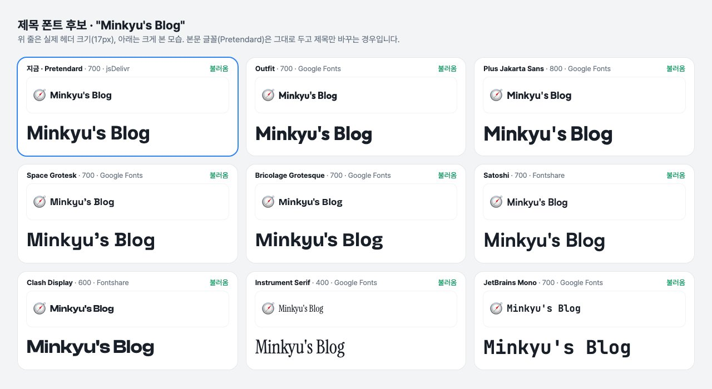

## 숫자는 맞는데 읽기가 불편했다

1편에서 잰 GitBook 수치로 화면을 만들고 나서, 직접 글을 띄워 보니 세 가지가 걸렸다.

- **제목이 너무 크다.** 글 제목 36px 이 본문 칸에서 혼자 튄다.
- **위계가 흐리다.** 제목 36px 과 소제목 30px 이 거의 같은 크기로 보인다.
- **한국어가 단어 중간에서 끊긴다.** "해결" 이 줄 끝에서 "해 / 결" 로 갈라졌다.

GitBook 의 숫자는 영어 문서와 Roboto 글꼴에 맞춘 값이었다. 한국어 긴 글에는 다른 기준이 필요했다.



## 기준: 토스 디자인 시스템

토스 디자인 시스템(TDS)은 글자 크기를 토큰으로 정해 공개해 두었다. 그중 다섯 개만 골라 역할을 붙였다. 크기는 이 다섯 단계만 쓰고, 굵기도 보통과 굵게 두 가지만 쓴다.

| 역할 | TDS 토큰 | 크기 / 행간 |
|---|---|---:|
| 글 제목 | Typography 1 | 30 / 40 |
| 큰 소제목 | Typography 3 | 22 / 31 |
| 작은 소제목 · 본문 | Typography 5 | 17 / 25.5 |
| 사이드바 · 표 · 힌트 | Typography 6 | 15 / 22.5 |
| 날짜 · 태그 · 목차 | Typography 7 | 13 / 19.5 |

토큰 값은 [TDS 문서의 Typography 쪽](https://tossmini-docs.toss.im/tds-mobile/foundation/typography/)에 있다.

## 긴 글은 토스 기술 블로그를 따라

TDS 는 앱 화면을 위한 기준이라, 긴 글의 행간과 줄바꿈까지 정해 주지는 않는다. 그래서 [토스 기술 블로그](https://toss.tech)의 글 페이지를 같은 방식으로 재 봤다. 본문은 17px 에 행간 1.6 이고, 한국어를 낱말 단위로 줄바꿈하고 있었다.

```css title="theme/static/style.css (줄임)"
:root {
  --t1: 30px; --t1-lh: 40px;     /* 글 제목 */
  --t3: 22px; --t3-lh: 31px;     /* 큰 소제목 */
  --t5: 17px; --read-lh: 1.6;    /* 본문 */
  --t6: 15px; --t7: 13px;
}
body {
  word-break: keep-all;          /* 한국어를 낱말 단위로 줄바꿈 */
  overflow-wrap: break-word;     /* 너무 긴 낱말만 쪼갬 */
}
```

`word-break: keep-all` 한 줄로 "해 / 결" 처럼 갈라지던 문제가 사라졌다.

간격도 4px 격자로 다시 정했다. 자리마다 쓰는 값이 정해져 있어서, 새 요소를 만들 때 고민할 일이 줄었다.

| 자리 | 간격 |
|---|---:|
| 문단 · 코드 · 표 · 힌트 사이 | 24px |
| 큰 소제목 위 / 아래 | 48px / 16px |
| 작은 소제목 위 / 아래 | 32px / 8px |
| 글 머리에서 본문까지 | 40px |

## 글꼴

토스가 쓰는 Toss Product Sans 는 공개 글꼴이 아니다. 그래서 본문은 많이 쓰이는 공개 글꼴인 Pretendard 로 했다.

헤더의 블로그 이름만은 로고처럼 보이고 싶어서 따로 골랐다. 후보 아홉 개를 실제 헤더 크기로 놓고 비교한 뒤, [Fontshare](https://www.fontshare.com) 의 Clash Display 로 정했다.



글꼴은 설정 파일에서 이름만 바꾸면 된다. 본문 글꼴은 그대로 두고 제목만 바뀐다.

```yaml title="site.yaml"
title: Minkyu's Blog
title_font: Clash Display
title_font_weight: 600
title_font_css: "https://api.fontshare.com/v2/css?f[]=clash-display@600&display=swap"
```

> [!NOTE]
> Fontshare 는 한 요청에 글꼴 두 개를 함께 달라고 하면 첫 번째만 돌려준다. 여러 개를 비교할 때는 글꼴마다 따로 불러와야 한다.

## 다음 편

다음 글에서는 기술 블로그에 꼭 있어야 하는 수식과 도표를 붙이면서 만난 함정을 적는다.
