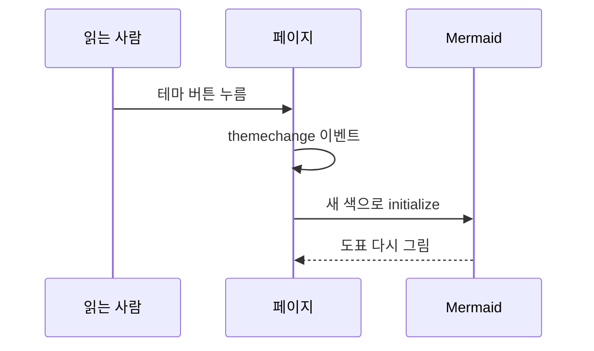

## 쓰는 글에서만 불러오기

수식은 KaTeX, 도표는 Mermaid 로 그린다. 둘 다 브라우저에서 돌아가는 라이브러리인데 Mermaid 는 파일이 5MB 가 넘는다. 모든 글에 붙이면 수식도 도표도 없는 글까지 무거워진다.

그래서 빌드할 때 글마다 수식이나 도표가 있는지 기록해 두고, 있는 글에만 스크립트를 넣는다. 스크립트 주소에는 버전을 고정하고 파일 해시(SRI)를 붙였다. 받아 온 파일이 한 바이트라도 다르면 브라우저가 실행하지 않는다.

```html title="theme/templates/page.html (줄임)"

<script src="https://cdn.jsdelivr.net/npm/mermaid@12.1.0/dist/mermaid.min.js"
        integrity="sha384-…" crossorigin="anonymous" defer></script>

```

## 수식

문장 안에서는 `$` 로, 따로 한 줄을 쓸 때는 `$$` 로 감싼다. 예를 들어 `poll` 은 감시하는 fd 가 $n$ 개면 부를 때마다 $O(n)$ 만큼 일한다.

$$
T_{\text{poll}}(n) \approx c \cdot n
$$

가격처럼 `$5` 가 들어간 문장이 수식으로 바뀌면 곤란하다. 그래서 `$` 바로 앞뒤에 빈칸이나 숫자가 붙으면 수식으로 보지 않게 했다.

```python title="build.py"
md.use(dollarmath_plugin, allow_space=False, allow_digits=False, allow_labels=False)
```

### 수식 속 한글

`\text{요청 수}` 처럼 수식에 한글을 넣으면 글자 사이가 이상하게 벌어졌다. KaTeX 는 한글을 따로 감싸는데, 그 글꼴이 수식용 글꼴로 지정되어 있어서 결국 명조 계열로 떨어지고 있었다. 한글만 본문 글꼴을 쓰게 한 줄 더해서 해결했다.

```css title="theme/static/style.css"
.katex .hangul_fallback, .katex .cjk_fallback { font-family: var(--font); }
```

## Mermaid 12 의 기본값

Mermaid 는 코드 블록에 글로 적은 도표를 그림으로 바꿔 준다. 붙이는 것은 쉬웠는데, 12판의 기본값 때문에 다섯 번 막혔다.

| 증상 | 원인 | 바꾼 것 |
|---|---|---|
| 가로 흐름도가 1,200px 까지 퍼져 글자가 7px 로 줄어듦 | 기본 배치가 elk 이고, 상자마다 최소 폭이 120px | `layout: "dagre"`, `minNodeWidth: 0` |
| 상자마다 회색 그림자 | 기본 모양 "neo" 가 그림자를 넣음 | CSS 로 그림자 끔 |
| 순서도 글자만 16px | 위쪽 `fontSize` 설정이 순서도 설정을 덮음 | `fontSize: 15` |
| 도표 세 개가 한 칸에 겹쳐 그려짐 | id 를 시계로 만들어서, 시계가 멈춘 환경에선 같은 id 가 나옴 | `deterministicIds: true` |
| 상자 글자가 "끼 / 우기" 처럼 갈라짐 | 상자 글자를 120px 에서 줄바꿈 | `wrappingWidth: 200` |

네 번째 문제는 화면을 자동으로 찍으려고 쓴 헤드리스 Chrome 에서만 나타났다. 실제 브라우저에서는 시계가 흐르니 id 가 겹치지 않지만, 순번으로 id 를 만들게 바꿔서 어디서든 겹치지 않게 했다.

```js title="theme/static/app.js (줄임)"
mermaid.initialize({
  theme: "base", themeVariables: dark ? DARK : LIGHT, fontSize: 15,
  deterministicIds: true, deterministicIDSeed: "tech-blog",
  layout: "dagre",
  flowchart: { minNodeWidth: 0, wrappingWidth: 200, padding: 12, nodeSpacing: 30, rankSpacing: 36, curve: "basis" },
});
```

색은 토스 디자인 시스템의 회색과 파랑으로 라이트·다크 두 벌을 만들었다. 테마를 바꾸면 도표를 다시 그린다.



## 다음 편

다음 글에서는 글이 많아졌을 때를 대비해 폴더와 시리즈를 만든 과정을 적는다. 지금 읽고 있는 이 시리즈 상자도 그때 만들었다.
