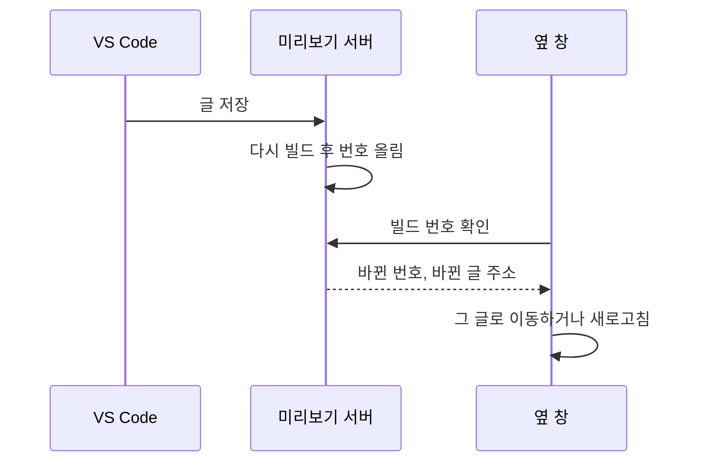
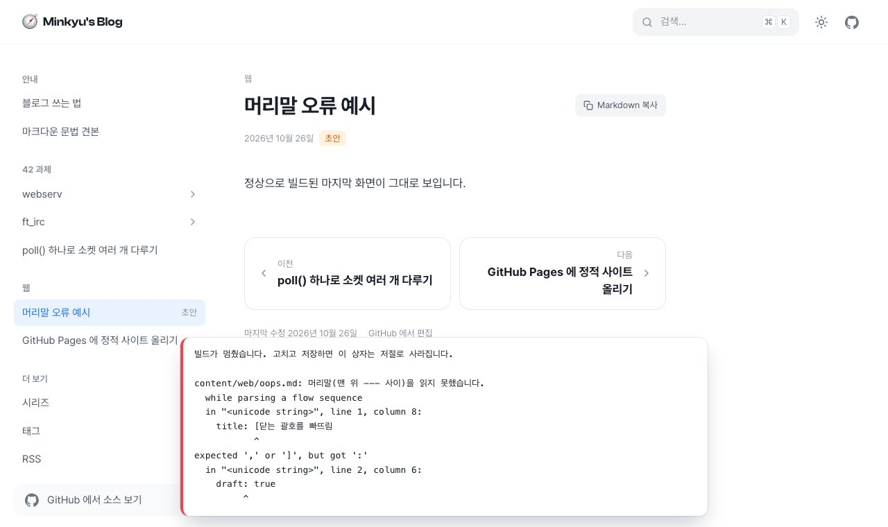

## 원하는 흐름

1. VS Code 에서 마크다운으로 글을 쓴다.
2. 옆 창에서 실제 블로그 모습을 보면서 고친다.
3. 다 쓰면 GitHub 에 올린다.

그리고 설계 메모(`DESIGN.md`)와 나만 보는 안내 글은 내 컴퓨터에만 두고 싶었다.

## 저장하면 옆 창이 저절로 바뀌게

미리보기 서버는 0.5초마다 파일이 바뀌었는지 보고, 바뀌면 사이트를 다시 빌드한다. 열려 있는 브라우저 창은 0.6초마다 서버에 빌드 번호를 묻고, 번호가 바뀌면 새로고침한다.



여기에 세 가지를 더했다.

- **스크롤 유지:** 새로고침해도 보던 위치로 돌아간다.
- **따라가기:** 다른 글을 저장하면 옆 창이 그 글로 넘어간다. 새 글을 만들 때 주소를 몰라도 된다.
- **오류 상자:** 머리말을 잘못 적으면 마지막으로 성공한 화면은 그대로 두고, 아래에 어느 파일 몇째 줄이 틀렸는지 보여 준다.



화면이 깨지지 않게 하려고 새 빌드는 `_site.next` 에 따로 만들고, 성공했을 때만 한 번에 바꿔 끼운다.

### VS Code 에서

VS Code 의 기본 마크다운 미리보기는 블로그 디자인이 아니라서, 내장 웹 브라우저인 Simple Browser 로 미리보기 서버를 연다. 서버는 폴더를 열 때 저절로 켜지게 작업으로 등록했다.

```json title=".vscode/tasks.json (줄임)"
{
  "label": "블로그 미리보기",
  "type": "shell",
  "command": "uv run --no-project dev.py 4900",
  "isBackground": true,
  "runOptions": { "runOn": "folderOpen" }
}
```

## 올리지 않을 것 나누기

나누는 기준은 `.gitignore` 다. 로컬 전용 목록에 적은 파일은 git 이 추적하지 않으니 GitHub 에 올라가지 않는다.

```text title=".gitignore (일부)"
# 로컬 전용: 이 컴퓨터에만 두고 GitHub 에는 올리지 않음
DESIGN.md
content/guide/
.vscode/
```

생성기는 `git check-ignore` 로 이 목록을 읽는다. 미리보기에서는 로컬 전용 글에 "로컬" 표시를 붙여 보여 주고, 배포용으로 빌드할 때는 빼서 GitHub 에서 만드는 사이트와 같은 결과를 낸다.

| 글 | 미리보기 | GitHub 저장소 | 사이트 |
|---|:---:|:---:|:---:|
| 표시 없음 | 보임 | 올라감 | 보임 |
| 초안 (`draft: true`) | 보임 | 올라감 | 안 보임 |
| 로컬 (`.gitignore`) | 보임 | 안 올라감 | 안 보임 |

> [!WARNING]
> 초안은 사이트에만 안 나올 뿐 저장소에는 올라간다. 공개 저장소라면 누구나 파일을 읽을 수 있으니, 남에게 보이면 안 되는 메모는 초안이 아니라 로컬 전용으로 둬야 한다.

## 이미 커밋한 파일은 기록에서도

문제가 하나 남았다. `DESIGN.md` 와 안내 글은 나누기 전에 만든 v1·v2 커밋에 이미 들어 있었다. 지금 파일만 빼고 올리면, 옛 커밋을 통해 그대로 올라간다.

아직 한 번도 올리지 않았으니 기록을 다시 써서 해결했다. 먼저 모든 브랜치와 태그를 묶음 파일로 백업하고, 그 묶음에서 실제로 되살아나는지 확인한 뒤에 손댔다.

```bash
# 1. 백업: 모든 브랜치·태그를 파일 하나로
git bundle create backup.bundle --all

# 2. 모든 커밋에서 두 경로를 지우고, 태그도 새 커밋으로 옮김
git filter-branch --index-filter \
  'git rm -r -q --cached --ignore-unmatch -- DESIGN.md content/guide' \
  --tag-name-filter cat -- --all

# 3. 어느 브랜치·태그에서도 그 파일에 닿지 않는지 확인 (0 이면 성공)
git rev-list --objects --all | grep -cE ' (DESIGN\.md|content/guide)(/|$)'
```

> [!CAUTION]
> 기록을 다시 쓰면 커밋 번호가 모두 바뀐다. 이미 올린 저장소에서 하면 다른 사람의 기록과 어긋나니, 처음 올리기 전에만 하는 것이 안전하다.

파일은 내 컴퓨터에 그대로 남고, 저장소 기록에서만 사라졌다.

## 다음 편

남은 것은 GitHub Pages 에 처음 올리는 일이다. 저장소를 만들고 배포가 실제로 돌아가면, 그 과정을 이어서 적을 생각이다. 배포 설정 자체는 [GitHub Pages 에 정적 사이트 올리기](../web/github-pages-static.md)에 먼저 정리해 두었다.
